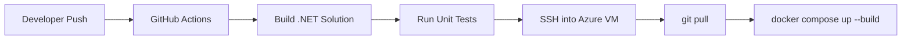
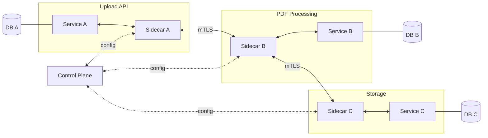
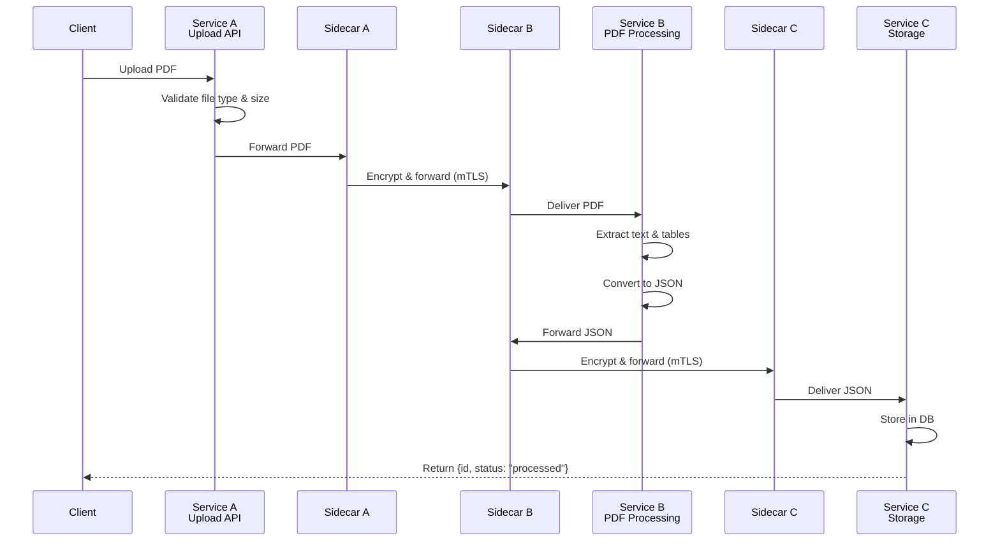

This project was completed for PROG3176 – Winter 2026 – Section 1. The objective of the assignment was to demonstrate a distributed application composed of multiple services communicating with each other. It also incorporates cloud deployment, a CI/CD pipeline, and key software design principles.

# Project Team

[Juhwan Seo](https://github.com/Juhwan21st)
[Nathan Dinh](https://github.com/Nathan-Dinh)

**Demo:** http://20.151.96.43:5173

# Assignment Rules

## Services

- Each service must have a **clear responsibility**
- Each service must have its **own database** (EF Core)
- Services must **communicate via HTTP**
- Each service must **run independently**
- Each service must be a **.NET Web API** with controllers, models, and REST endpoints (CRUD minimum)

## Workflow

- Must demonstrate a **multi-step interaction** across services (A → B → C)
- Data flows through multiple services before returning a result

## CI/CD

- GitHub Actions pipeline - build and deploy on push

## Group Size (2 Students)

- Minimum **4 unit tests**
- Must include a slightly more complex workflow (multi-step processing)

## Cloud Deployment

- Deploy at least **one service** to any cloud provider
- Must be **publicly accessible**

# Architectural Design

## Deployment Flow

## Service Mesh Architecture

## PDF to JSON Flow

# Technical Stack

- **Frontend** - Vue.js + nginx
- **Backend** - .NET 9 / ASP.NET Core
- **Database** - SQLite (EF Core, per-service)
- **Service Mesh** - Custom sidecar proxy + control plane
- **Containerization** - Docker / Docker Compose
- **CI/CD** - GitHub Actions (build + test + SSH deploy)
- **Cloud** - Azure VM (Ubuntu 24.04 LTS)

# Service Overview

## Core Services

- **Service 1 - Frontend (Vue)**
  - Basic UI where users upload PDF files
  - Sends the PDF to Service 2 through the mesh

- **Service 2 - PDF Handler**
  - Receives the uploaded PDF from the frontend
  - Validates file type, size, and format
  - Passes the valid PDF to Service 3 for processing
  - SQLite - stores upload logs

- **Service 3 - PDF Processing Service**
  - Receives the raw PDF
  - Extracts text, tables, and structure from the PDF
  - Converts extracted data into JSON format
  - Sends the JSON to Service 4 for storage
  - SQLite - stores processing logs

- **Service 4 - Storage Service**
  - Receives the JSON output
  - Stores the document in the database
  - Exposes an endpoint to retrieve stored JSON by ID
  - SQLite - stores the converted documents

## Mesh Services

- **Service 5 - Sidecar Proxy**
  - Runs alongside each core service
  - Intercepts all incoming/outgoing traffic
  - Handles mTLS encryption, retries, logging, and auth policies
  - One project, runs as multiple instances with different config

- **Service 6 - Control Plane**
  - Central config server for all sidecars
  - Stores routing rules, auth policies, and retry config
  - Sidecars check in periodically to fetch updated config

---

# Project Rationale

The goal of this project was to explore a real-world networking architecture beyond basic service-to-service communication. We chose to implement a **service mesh** because it addresses a core challenge in distributed systems. Managing networking logic across multiple services without duplicating code or creating inconsistencies.

To give each service a meaningful purpose, we paired the mesh with a **PDF-to-JSON processing pipeline**. This combination allowed us to demonstrate the mesh handling real traffic between services that each have a clear, distinct responsibility. Uploading, processing, and storing data.

Together, the service mesh and the processing pipeline showcase how infrastructure and application concerns can be separated while working in coordination.

---

For detailed reference on PDF processing, service mesh concepts, .NET internals, and project structure, see [Docs/APPENDIX.md](Docs/APPENDIX.md).
